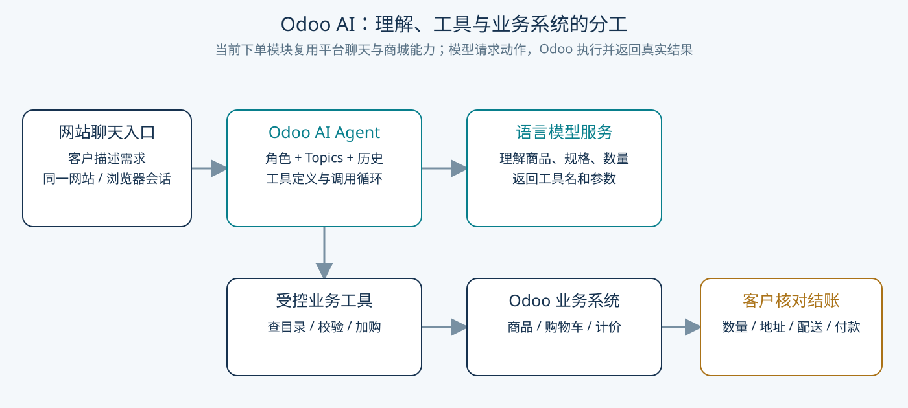
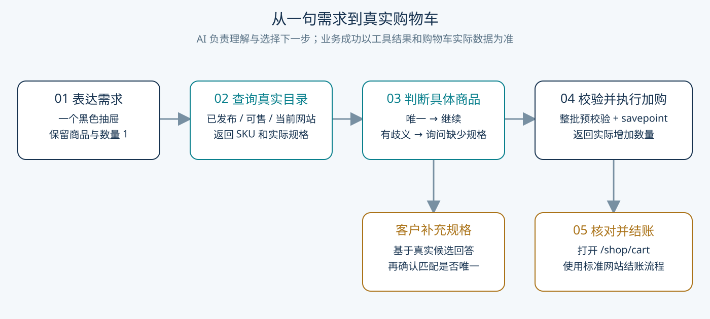
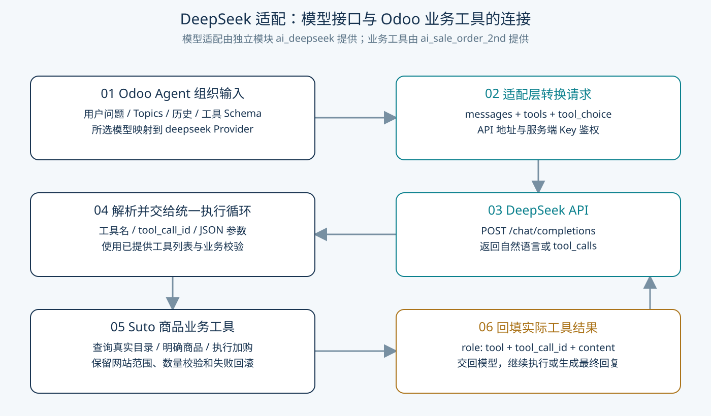

# Odoo 19 AI 功能开发与说明文档

**以 Suto 网站聊天快捷下单模块 `ai_sale_order_2nd` 与 DeepSeek 接入为例**

编制：Suto · 版本：1.3 · 日期：2026 年 11 月 16 日

适用读者：客户业务负责人、项目经理、实施顾问、Odoo 开发人员。

本文根据当前工作区的 Odoo 19 企业版 AI 源码及 Suto 模块编写。文中的“当前实现”指本项目已存在的代码和此前验证过的流程；“框架能力”与“后续扩展”分别标明，避免把可开发的能力当作已交付功能。模型供应商支持、安装模块、授权及商品配置以实际部署为准。

## 阅读建议

第一次了解此功能，建议先阅读第 1～5 章，理解业务结果、系统分工和实际下单过程，再读第 15 章的 DeepSeek 方案。准备客户会议，再阅读第 11～13 章，并使用随附的《客户会议讲解与演示指南》。需要开发、部署或排障，继续阅读第 6～10 章及随附《开发技术参考》《DeepSeek 适配实现与交付说明》。

本文回答四个问题：Odoo 如何把 AI 接进业务系统；本模块如何把一句话变成真实购物车；如何通过独立模块接入 DeepSeek；向客户介绍时，哪些能力可以演示，哪些还需要开发和验收。版本 1.3 对应已完成的源码还原、适配拆分与模型目录自动同步：DeepSeek 由 `ai_deepseek` 提供，购物工具由 `ai_sale_order_2nd` 提供，企业版 AI 核心文件已恢复。

## 1. 用一分钟理解本项目

我们把语言模型的理解能力连接到 Odoo 的业务工具。客户在网站聊天框说“帮我下单一个黑色抽屉”，AI 识别商品、数量和购买意图，再调用 Odoo 查询真实商品目录。商品唯一且数量明确时，Odoo 将商品加入这个客户当前的网站购物车，并返回购物车链接。客户随后按网站标准结账流程核对价格、地址、配送和付款。

**当前网站功能的业务完成点是“商品已加入购物车”。** 这个结果可以通过打开 `/shop/cart`、查看真实商品行和数量来验证。订单确认、发票、付款和发货继续遵循网站已经配置的标准流程。

这一功能适用于商品较多、规格较多，或客户习惯直接描述需求的场景。它减少客户逐页找商品和重复选择的操作，也可以在需求不完整时询问缺少的规格。

对客户可以这样介绍：

> 客户可以用自然语言说明需要的商品，系统会查询商城中的真实产品。有明确匹配时帮助加入购物车；规格不清楚时询问实际可选项。客户可以在购物车中核对，再完成标准结账。

## 2. Odoo 19 的 AI 功能由哪些部分组成

### 2.1 平台层、模型层和业务层

Odoo 提供业务数据、权限、会话和工具执行机制；语言模型提供自然语言理解和回答生成；开发模块把允许执行的业务动作封装成工具。三者需要一起配置。



| 部分 | 可以理解为 | 本项目中的例子 |
| --- | --- | --- |
| 聊天入口 | 客户和系统交流的界面 | 网站右下角在线客服，或页面 AI 聊天区块 |
| AI Agent，智能体 | 一个有角色、模型和业务能力配置的助手 | `Livechat AI Agent` |
| LLM，语言模型 | 理解语句、判断下一步和组织回答的服务 | 模型目录由 `ai_deepseek` 从 DeepSeek `/models` 获取；旧购物验证使用 `deepseek-chat` |
| Topic，主题 | 一组业务指令和工具 | `Website Cart Ordering` |
| Tool，工具 | 一个允许 AI 请求执行的固定业务动作 | 查询网站商品、加入购物车 |
| JSON Schema | 工具参数的格式说明 | 商品名称数组、数量数组、备注 |
| ORM | Odoo 读取和修改业务数据的标准接口 | 查询 `product.product`，更新 `sale.order.line` |
| Sources / RAG | 给助手参考企业资料的机制 | 产品手册、公开 FAQ；属于可选配置 |
| Session，会话 | 当前浏览器与网站的身份及状态 | 购物车 ID、登录状态、访客身份 |

可以把 Agent 理解为助手岗位，Topic 是岗位的业务操作规则，Tool 是岗位可使用的业务按钮。规则告诉助手何时用哪个按钮，代码决定按钮实际能做什么。

### 2.2 当前源码中的模块分工

| 模块 | 职责 | 与本项目的关系 |
| --- | --- | --- |
| `ai` | Agent、Topic、模型适配、工具调用、聊天、知识检索等基础能力 | 核心基础 |
| `ai_app` | AI 应用及 Agent、Topic 等管理界面 | 本模块直接依赖 |
| `im_livechat` / `website_livechat` | 在线客服、访客会话、网站客服入口 | 提供网站聊天渠道 |
| `ai_livechat` | 让 AI Agent 接入在线客服，并支持转接 | 网站聊天集成 |
| `ai_website` | 网站编辑器中的 AI 能力，例如生成页面内容 | 与客户聊天的职责不同 |
| `ai_website_livechat` | 网站编辑器中的 AI 聊天区块及相应集成 | 页面聊天入口 |
| `sale` / `website_sale` | 销售报价单、商城商品、购物车及结账业务 | 真正执行销售业务 |
| `ai_deepseek` | DeepSeek 模型发现、缓存、独立 API 服务、Key 设置及能力校验 | 本项目独立模型适配模块，依赖 `ai_app` |
| `ai_sale_order_2nd` | 销售草稿报价及网站商品查询、加购工具 | 本项目定制开发 |

本地还存在 AI 文本写作、知识应用集成、CRM 线索、AI 字段和服务器动作等模块。它们展示同一套基础能力如何进入不同业务入口；不代表本下单模块已经覆盖这些场景。当前文档涉及的核心 AI 应用和网站 AI 集成位于企业版源码，实际使用需核对相应授权和部署条件。

### 2.3 不需要先训练模型记住商品

当前商品下单流程使用“提示规则 + 实时业务工具”。商品新增、发布或修改规格后，工具查询当前数据库；不需要每次重新训练语言模型。

知识资料问答可以采用 RAG：先检索手册或 FAQ 中的相关片段，再交给模型回答。商品目录查询和资料检索可以共同服务一个助手，但它们的数据来源、更新方式和权限控制不同。第 8 章单独说明知识库。

### 2.4 网站 AI 聊天是原生功能吗

**本项目使用的网站 AI 聊天界面及接入机制，来自 Odoo 19 企业版原生模块。** 我们复用这些入口和对话能力，再接入当前 DeepSeek 适配及 Suto 商品业务工具。

| 客户看到或使用的部分 | 来源 | 本项目的工作 |
| --- | --- | --- |
| 网站右下角在线客服 | `im_livechat`、`website_livechat` | 配置网站、频道及匹配规则 |
| 在线客服由 AI Agent 接待 | 企业版 `ai`、`ai_app`、`ai_livechat` | 配置 Agent、模型、指令和工具 |
| 页面中的 AI 聊天区块 | 企业版 `ai_website_livechat` | 在页面选择 Agent 与聊天样式 |
| AI 理解需求后调用业务动作的机制 | 企业版 AI 工具调用框架 | 注册本项目需要的具体业务工具 |
| 当前 DeepSeek 模型接入 | Suto 独立模块 `ai_deepseek` | 继承 Agent 并提供独立服务，配置凭据并独立验收 |
| 查询网站商品、加入购物车、创建草稿报价 | Suto `ai_sale_order_2nd` | 定制 Python 方法、工具 Schema 与 Topic 工作规则 |

因此，客户会议可以说“基于 Odoo 19 企业版原生 AI 聊天框架，接入 DeepSeek，并开发商城下单工具”。原生能力仍需要安装相应模块、配置模型凭据和网站入口；不是所有社区版安装、或仅安装下单模块后，就自动获得完整网站 AI 方案。本模块没有另写聊天 UI、JavaScript 消息链路或模型请求控制器。

## 3. 本模块到底实现了什么

### 3.1 三个工具、两个 Topic、两条业务流程

模块通过继承 `ai.agent` 增加 Python 业务方法，通过 XML 注册工具和 Topic。它复用 Odoo 已有的聊天界面、模型调用和电商流程。

| 工具 | 输入 | 当前实际结果 |
| --- | --- | --- |
| `AI: Search Website Products` | 商品名、SKU、条码或规格关键词 | 返回当前网站可用商品的真实名称、SKU 和规格；不新增购物车商品 |
| `AI: Add Products To Website Cart` | 商品名称或编码数组、对应数量、备注 | 将确定的商品增量加入当前网站购物车，返回实际增加数量和购物车入口 |
| `AI: Create Draft Sale Order` | 商品名称或编码数组、对应数量、备注 | 按当前执行用户关联的客户创建一张草稿销售报价单 |

网站 Topic `Website Cart Ordering` 关联商品查询和加购物车两个工具。内部 Topic `Sale Order Creation` 关联草稿报价单工具。

### 3.2 网站购物车与后台报价单的区别

| 项目 | 网站聊天加购物车 | 后台 AI 创建草稿报价单 |
| --- | --- | --- |
| 面向用户 | 网站访客、Portal 客户 | 具备相关权限的内部用户 |
| 业务对象 | 当前浏览器会话已有或新建的购物车 | 新建一张草稿报价单 |
| 客户来源 | Odoo 网站的会话、访客及登录客户机制 | 当前执行用户的 `partner_id` |
| 执行方式 | 标准网站购物车方法 | 标准销售单 ORM 创建 |
| 结果查看 | `/shop/cart` | 相关权限下的销售报价单 |
| 继续处理 | 网站标准结账流程 | 业务人员复核并走销售流程 |

两者底层都可能使用 `sale.order`，但业务上下文不同。网站购物车通常也是草稿状态的销售单，所以“数据库已有销售单记录”不等于“订单已确认”或“付款已成功”。

后台工具当前固定使用执行用户所关联客户，并没有“替任意指定客户建单”的参数。此工具没有提升销售单创建权限；使用者需要具有相应销售权限。网站 Topic 应使用网站购物车工具，避免让 Portal 客户走内部销售创建路径。

### 3.3 当前能力与扩展范围

| 场景 | 当前状态 | 说明 |
| --- | --- | --- |
| 商品名、SKU、条码查找 | 已实现 | 以真实商城目录为准 |
| 多商品及数量批量加购 | 已实现 | 一次失败批次整体回滚 |
| 规格不明确时保留候选 | 已实现 | AI 应询问真实缺失规格 |
| 中文界面及英文商品名兼容 | 已实现部分处理 | 支持当前语言与英语回退、混合关键词；仍依赖目录质量和模型理解 |
| 当前网站范围及发布状态检查 | 已实现 | 已发布、可销售、当前网站或共享商品，并经过可加购检查 |
| 报价单创建 | 已实现独立工具 | 仅草稿，客户固定为当前执行用户关联客户 |
| 精确实时价格、库存问答 | 没有专门实现查询工具 | 当前搜索结果不含价格与库存；商城价格继续由 Odoo 计算 |
| 更改数量、删除行、清空购物车 | 没有专门实现聊天工具 | 可在标准购物车页面操作 |
| 自动确认订单、开票、收款、退款 | 未在本模块实现 | 如要开放，需另建业务工具和流程控制 |
| 复杂定制配置器、任意单位小数购买 | 未完整覆盖 | 网站工具当前数量须为正整数；没有暴露完整配置器参数 |
| 成功请求的数据库级防重复提交 | 未实现 | 当前具备失败批次回滚，成功后重复调用仍会增加数量 |
| 产品资料知识库问答 | Odoo 框架可配置；本版 DeepSeek 适配不支持 | DeepSeek Agent 禁止关联 Sources；采用其他已支持的 Provider 或另行开发检索方案 |

## 4. 从客户一句话到购物车：完整过程

### 4.1 业务视角



1. 客户表达需求，例如“帮我下单一个黑色抽屉”。
2. AI 识别购买意图，保留“黑色抽屉”和数量 1。
3. AI 请求商品查询工具，Odoo 返回真实目录结果。
4. 唯一商品满足需求时继续；多个真实规格均可能满足时，只问缺少的规格。
5. AI 请求加购工具，Odoo 完成参数、商品和购物车校验。
6. Odoo 执行标准加购方法，返回实际结果。
7. AI 根据结果回复，并提供 `/shop/cart` 链接。
8. 客户打开购物车核对，继续标准结账。

### 4.2 技术视角

浏览器先把客户发言保存为 `mail.message`。前端发现当前 `discuss.channel` 关联了 `ai_agent_id`，再调用 `/ai/generate_response`。

Odoo 控制器检查当前身份能访问的频道和消息，调用 Agent。Agent 把角色提示、Topic 指令、近期对话、当前问题和允许调用的工具描述交给模型。使用支持知识检索的 Provider 且配置 Sources 时，还会检索资料片段；本版 DeepSeek Agent 只走文本与工具路径，禁止关联 Sources。

模型可能直接回答，也可能返回“工具名 + JSON 参数”。Odoo 检查工具在已提供的列表中，并校验参数，然后执行预先配置的服务器动作。工具返回结果后，Odoo 将结果交回模型，模型决定继续搜索、追问，或生成最终回复。

最终回复由 Odoo 转为经过清理的 HTML，以 Agent 身份发布到聊天频道，浏览器显示消息。本地这条聊天链路以 JSON-RPC 请求等待处理完成；“正在思考”的状态不代表模型文本已经逐字流式传输。

### 4.3 一个可看懂的工具调用例子

下面是说明性参数示例，具体调用轮数由模型实际行为决定。

第一次，AI 请求查询：

```json
{
  "query": "黑色抽屉"
}
```

Odoo 在当前测试目录中返回的关键事实可以表示为：

```json
{
  "products": [
    {
      "name": "[FURN_8900] 黑色抽屉",
      "reference": "FURN_8900",
      "catalog_name": "Drawer Black",
      "attributes": []
    }
  ],
  "has_more": false
}
```

实际结果还包括 `product_id`。名称随界面语言和数据库内容变化，示例用于解释当前测试目录。

随后，AI 使用真实 SKU 请求加购：

```json
{
  "product_names": ["FURN_8900"],
  "quantities": [1],
  "note": ""
}
```

执行成功后，工具返回实际增加数量及 `/shop/cart`。AI 可以回复：“已为你把 1 个黑色抽屉加入购物车，点击购物车核对并继续结账。”

**判断成功要看工具执行结果及购物车数据。** “我来帮你添加”这样的过程性表达并不表示数据已经更新。

### 4.4 谁负责价格，谁负责商品和数量

AI 负责从客户表达中提取需求，不应该自行编造商品 SKU、价格或库存。工具从真实业务数据中找商品，标准购物车方法依据网站的价目表、税务和相关规则计算业务数据。

当前查询工具主要返回商品身份和规格，没有价格、库存字段。若客户要求 AI 报实时价格、判断库存充足或保证交期，需要补充相应查询工具及验证。安装了库存相关电商扩展时，标准加购流程可能应用相应规则，但不能据此把专门的库存问答能力列为已实现。

## 5. 配置时最重要的六个概念

### 5.1 Agent：谁来接待

Agent 配置了名称、模型、系统提示词、回答风格、Topics 和 Sources。模型选项来自 `ai_deepseek` 已同步的数据库目录；历史测试网站使用 `Livechat AI Agent` 的 `deepseek-chat` 标识。

Agent 有一个关联的联系人身份，用于在聊天中显示作者；这个“AI 作者”不同于工具执行时当前登录用户的业务权限。执行身份与消息显示身份应分别理解。

### 5.2 Provider 与 Model：通过哪家服务、用哪个模型

Provider 是供应商适配；Model 是供应商的具体模型。恢复后的核心 Provider 列表包含 OpenAI、Google；安装 `ai_deepseek` 后，通过 Agent 模型继承增加 DeepSeek 选项和服务映射。

本项目通过独立二开模块 `ai_deepseek` 自动获取 DeepSeek 模型目录。企业版 `llm_api_service.py`、`llm_providers.py` 已还原到当前 Git 基准；扩展不修改全局 Provider 列表，也不替换核心服务类。功能只在安装该模块的数据库注册表中启用。

保存变化后的 DeepSeek Key 时会同步 `/models`，每日定时任务会刷新目录，管理员也可手动刷新。模型下拉框只读当前数据库的缓存；缺 Key 或同步失败保留上次成功目录，正在使用的旧模型不会被自动切换。普通动态型号采用非思考模式，以兼容原生 Odoo 的历史消息格式。

模型选择和密钥必须匹配。配置了 DeepSeek 密钥，却让 Agent 使用 OpenAI 的模型，仍然会失败。切换网站 Agent 的模型也不会自动改变所有 AI 入口，例如自动化 AI Action 有独立的模型使用路径。

### 5.3 Topic：助手遵循怎样的业务步骤

网站 Topic 指导 AI 先查目录、保存原问题里的数量、用真实 SKU、歧义时追问、成功后给购物车链接。

**当前实现会合并 Agent 关联的全部 Topic 指令与工具。** Topic 是同一个助手的能力配置，不是模型先选择一个独立机器人再运行。给网站购物助手挂过多后台导航、线索创建或其他无关主题，可能增加上下文、费用和行为冲突。

### 5.4 Tool：助手能申请执行什么

工具描述告诉模型“什么时候使用”，Schema 告诉模型“传哪些参数”，固定代码负责“实际执行什么”。

当前网站工具没有订单确认和付款方法，AI 即使生成一句“已付款”，也不会通过现有工具真的完成收款；这种回复仍属于错误，验收应以真实数据为准。提示规则需要与后端能力和结果校验一起使用。

### 5.5 Sources：助手可以参考哪些资料

Sources 用于手册、FAQ 等资料问答，和 Topic 中的工具不同。Sources 提供知识，工具执行动作。本版 `ai_deepseek` 没有 embedding 支持，会阻止 DeepSeek Agent 关联 Sources；需要资料问答时采用已有支持的 Provider，或另行设计适配。公开网站 Agent 的资料范围及权限注意事项见第 8、9 章。

### 5.6 Session：这是谁的购物车

网站购物车与当前 HTTP 会话关联。同一用户换浏览器、打开无痕窗口或更换登录身份时，购物车可能不同；登录后是否合并或找回已有购物车由标准商城机制处理。

演示时，在同一浏览器、同一网站、同一测试登录状态下聊天，再打开购物车。跨域嵌入客服的功能存在，不代表任意外部网站自动共享本商城购物车；跨域场景需单独核对 Cookie、身份和网站归属。

## 6. 本模块的开发结构与关键方法

### 6.1 文件各自负责什么

```text
ai_sale_order_2nd/
├── __init__.py
├── __manifest__.py
├── models/
│   ├── __init__.py
│   └── ai_agent.py                  # 商品查询、解析、加购、报价业务
├── data/
│   └── ai_sale_order_tool_data.xml   # 3 个工具、2 个 Topic
├── tests/
│   └── test_ai_website_cart.py       # 网站工具回归测试
└── docs/                            # 本次编写的说明与会议资料
```

当前 manifest 直接依赖 `ai_app`、`sale`、`website_sale`、`website_livechat`、`ai_livechat`、`ai_website_livechat`，安装时会带上商城、网站客服和页面 AI 聊天区块所需模块，并加载工具和 Topic 数据。安装后仍需配置网站/客服绑定；本模块没有自动创建 Agent，也没有自动把 Topic 挂到已有 Agent。

### 6.2 Python 与 XML 为什么缺一不可

Python 实现业务方法，例如：

```python
class AIAgent(models.Model):
    _inherit = "ai.agent"

    def _ai_tool_search_website_products(self, query):
        # 校验当前网站，查询真实目录，返回商品信息
        ...
```

XML 把这个业务方法注册为 AI 可以认识的工具：

```xml
<record id="ir_actions_server_ai_search_website_products"
        model="ir.actions.server">
    <field name="name">AI: Search Website Products</field>
    <field name="model_id" ref="ai.model_ai_agent"/>
    <field name="state">code</field>
    <field name="use_in_ai" eval="True"/>
    <field name="ai_tool_allow_end_message" eval="False"/>
    <field name="code">
ai['result'] = record._ai_tool_search_website_products(query)
    </field>
    <!-- 完整定义中还包含 description 与 JSON Schema -->
</record>
```

这里的代码是预先由开发者写好的固定调用。模型输出的是工具名和参数，工具执行结果通过 `ai['result']` 交回框架。模型不直接连接数据库，也不通过这一接口任意生成 Python 去执行。

### 6.3 Schema 是接口约定，业务校验仍放在 Python

网站加购工具使用 `product_names`、`quantities` 两个数组，一一对应；`note` 在没有备注时传空字符串。

```json
{
  "product_names": ["DESK0005", "DESK0006"],
  "quantities": [1, 2],
  "note": ""
}
```

这表示第一种商品再加 1 件，第二种再加 2 件。当前是“增加数量”，不是把已有行的总数设置为这些值。

框架会校验工具参数，但并非实现 JSON Schema 的所有约束。因此数组长度一致、商品存在、数量合理、允许执行等规则都必须由业务方法强制检查。当前网站方法特别要求数量为正的有限整数，拒绝小数、负数、零、布尔值和无效数值。

### 6.4 商品模板与商品变体：本次故障的核心知识

Odoo 中，`product.template` 通常表达一个商品系列，`product.product` 表达具体变体。例如同一款桌子可能有白色、黑色和不同桌腿材质，实际加入购物车必须指向一个确定变体。

商品基础名称 `name` 可能是 `Two-Seat Sofa`；界面显示名称 `display_name` 则会组合成 `Two-Seat Sofa (Velvet)`。界面显示得出来，不代表只按基础名称字段搜索完整显示串就能找到。

当前模块优先用 SKU、条码，再结合商品名与规格值关键词解析；能唯一确定时返回商品，多条时返回真实候选，要求补充规格。只说“白色可定制化桌子”可能还缺桌腿材质，此时追问是正确的业务消歧。

SKU 有助于确定具体商品，但客户不需要事先知道 SKU。AI 应先根据客户描述查询，再把工具返回的真实 SKU 用于后续操作。

### 6.5 多语言如何处理

当前工具同时尝试界面语言和英语，并处理部分混合关键词。AI 向客户回复中文时，后续工具参数仍应复制真实目录名称或 SKU。例如目录中规格是 `Velvet`，不能凭空把工具参数改成数据库不存在的中文商品全名。

翻译缺失、连续中文组合词、口语简称或商品数据不规范，仍可能需要 AI 拆分关键词、缩小搜索范围或追问。当前实现是关键词目录搜索，不是另建一个商品语义向量检索服务，不能承诺所有自然语言一次命中。

### 6.6 为什么要补齐网站上下文

AI 消息生成路由不是普通商城页面路由，不能假设它已经设置好购物车、价目表和税务位置。本模块的 `_ai_prepare_website_sale_request()` 补齐：

- `request.website`：当前网站。
- `request.cart`：当前会话购物车。
- `request.fiscal_position`：税务映射相关上下文。
- `request.pricelist`：当前价目表。

然后复用标准 `website._create_cart()`、`sale.order._cart_add()` 和 `_verify_cart_after_update()`。这样业务逻辑沿用商城已有的扩展点，避免另写一套与网页购物车不同的计价和加购流程。

### 6.7 为什么批量加购必须有事务保护

假设客户买三种商品，前两种已经添加，第三种匹配失败。AI 框架会把工具错误交给模型，让它尝试修正；工具抛错在这里不意味着整个工具调用自动回滚。如果直接重试三种商品，前两种可能被重复增加。

当前模块采用两层保护：先解析、校验全部商品与数量，之后才开始写入；把购物车创建、整批加购、最终校验及备注放入数据库 savepoint。异常时回滚该批数据库变更，同时恢复请求缓存和相关 session 值。

**失败批次整体回滚，与成功操作防重复是两个问题。** 当前没有持久化的请求幂等键；一次成功后再次调用同样的加购工具，商品仍会继续累加。Topic 要求 AI 成功后不要自行重复，但更严格的重复提交控制属于后续增强。

## 7. 部署和配置：从安装到真正能聊、能加购

### 7.1 一条完整配置链

```text
模型服务及对应密钥
    → AI Agent 选择正确模型
    → Agent 关联 Website Cart Ordering Topic
    → Topic 关联查询商品、加入购物车工具
    → 网站关联在线客服频道
    → 频道规则选择该 Agent，或页面 AI 区块指定 Agent
    → 当前网站有已发布、可售且规格明确的商品
    → 同一浏览器会话对话并打开购物车验证
```

安装模块只是这条链中的一部分。模型可用、聊天频道正确、工具已关联、商城可访问以及商品数据完整，缺一项都可能表现为“AI 没回复”或“不能下单”。

### 7.2 管理界面主要检查位置

| 配置对象 | 检查内容 | 常见入口或定位方式 |
| --- | --- | --- |
| AI Agent | 模型、启用状态、提示词、Topic、Sources | AI 应用 → Agents；界面语言不同名称可能变化 |
| Topic | 工作指令、绑定的工具 | AI 应用 → Topics |
| Tool | Use in AI、描述、Schema、固定执行代码 | Topic 工具列表，或开发者模式服务器动作 |
| 网站 | 域名、公司、电商访问条件、客服频道 | 网站设置 |
| 客服规则 | URL、国家、优先级、AI Agent、在线条件 | 在线客服频道 → 规则 |
| 页面聊天区块 | Agent、客服频道、弹窗或全屏样式 | 网站编辑器中的 AI 聊天区块 |
| 商品 | 发布、可销售、网站、SKU、规格和翻译 | 商品后台及商城页面 |

右下角客服与页面 AI 聊天区块可采用不同 Agent 配置，需要核实实际入口。转人工成功后，旧频道可能已移除 AI 关联；后续不会再自动请求 AI，应按实际客服流程处理或新建适当会话。

### 7.3 密钥配置与模型切换

当前模型适配从数据库系统参数优先取密钥，未配置时读取相应进程环境变量。DeepSeek 对应参数名为 `ai.deepseek_key`；文档与会议截图只展示参数名和配置状态，不展示实际值。

安装 `ai_deepseek` 后，AI 设置页会新增 DeepSeek API Key 输入项，仅系统管理员可读取设置字段，界面以密码方式显示。它复用已有 `ai.deepseek_key` 参数，不需要复制或重建客户 Key；也支持进程环境变量 `ODOO_AI_DEEPSEEK_TOKEN` 回退。数据库中的非空值优先于环境变量。

配置变更后先确认一次普通对话，再确认工具查询，最后确认加购。更换模型时，应重新验证中文数量、规格消歧、函数参数、错误恢复、成本和耗时，不能只验证“能回答你好”。

### 7.4 代码修改与数据修改的生效方式

修改 Python 需要运行中的 Odoo 进程加载新代码；通常重启服务。修改 XML 中的工具描述、Schema 或 Topic，需要把模块数据更新到数据库，单纯刷新网页或重启 Python 未必更新这些记录。

本项目此前排障同时涉及 Python 业务逻辑和数据库中保存的工具、Topic 配置。正式发布应使用受控的模块升级与验证流程。适配拆分已经完成，并已安装到当前数据库；客户环境仍需按自身版本、运行配置和部署窗口执行安装与验收。开发命令和更细步骤见《开发技术参考》。

## 8. 知识库 RAG：回答企业资料问题的另一条链路

### 8.1 RAG 如何工作

RAG 是“检索增强生成”：先找资料，再让模型结合资料组织答案。通常适合保修政策、安装手册和公开产品 FAQ 等。

```text
上传资料 / 提供 URL
    → 提取文本并分块
    → 调用 embedding 服务生成向量
    → 保存到 PostgreSQL pgvector

用户问题
    → 生成问题向量
    → 检索相关片段
    → 片段加入模型上下文
    → 模型生成回答
```

当前源码的核心对象为 `ai.agent.source`、`ir.attachment`、`ai.embedding`。文本分块目标约 1500 字符，检索默认取相关度最高的 5 个片段；这些是当前实现参数，不是业务效果承诺。

### 8.2 RAG 与本下单模块的配合

在已支持知识检索的模型方案中，例如客户先问“这款沙发如何保养”，可从公开手册检索；随后说“那给我来一个天鹅绒款”，再通过实时商品工具查找、明确规格并加购。这是框架可扩展的组合场景，本版 DeepSeek 适配尚未提供该知识路径。

当前商品工具不用 embedding；但 AI 基础模块安装 hook 会检查 pgvector 扩展，因此部署时仍需按当前源码准备数据库扩展。

### 8.3 当前知识库必须单独验证的点

独立 `ai_deepseek` 仅支持文本和业务工具，不登记未经验证的 `deepseek-embed`，并在 Agent 与资料来源模型上阻止 DeepSeek Agent 关联 Sources。文件、图片、PDF、embedding、语音不在本版支持范围；如果客户需要知识问答，应选择已有支持的 Provider，或另行设计可验证的检索与模型组合。

另一个关键点是资料权限：当前 `restrict_to_sources` 主要追加回答提示，不是数据库访问控制；资料“不能下载”与“不会被送入模型上下文”也不是同一件事。当前检索链路可能使用被标记为不可访问引用的正文，只隐藏引用显示。公开网站 Agent 应关联经过明确筛选的公开资料；如果需要混合内部资料，必须在检索层做硬过滤或分开 Agent 与资料范围。

## 9. 权限、业务控制和数据边界

### 9.1 哪些是代码约束，哪些是模型规则

| 控制点 | 当前由什么实现 | 实际含义 |
| --- | --- | --- |
| 使用指定工具 | 框架提供工具列表并校验工具名 | 模型只可请求当前提供的工具 |
| 参数格式 | Schema 校验 + Python 校验 | 无效参数可被拒绝 |
| 网站商城可访问 | `has_ecommerce_access()` | 登录限定网站可拒绝匿名加购 |
| 商品可用范围 | 已发布、可销售、网站域及可加购检查 | 不把普通未发布商品作为网站可买结果 |
| 商品规格歧义 | Python 返回多个候选并报错 | 不在工具中任意选第一个商品 |
| 加购失败无部分写入 | savepoint + session 恢复 | 一次调用失败不留下该批部分增加 |
| 成功后不要重复加购 | Topic 及工具描述 | 当前不是持久化幂等机制 |
| 只依据资料回答 | Agent 提示词 | 当前不是机密资料的硬性隔离机制 |

### 9.2 不应简单理解为“所有操作都继承当前用户权限”

框架执行工具时会关闭超级用户状态，但工具实现可以主动使用 `sudo()`。本模块网站商品查询就是如此：为了服务 Portal 和匿名商城用户，查询提升权限，再显式约束发布、可售和网站范围。

标准网站购物车也通过专门的提权机制创建和访问订单，所以 Portal 用户能购物不意味着其获得了后台所有销售权限。反过来，服务器动作的分组设置也不应被当作网站工具的唯一保护，AI 工具路径有特定的执行检查方式。

`with_company()` 设置公司上下文，不能单独作为严格的多公司数据隔离证明。涉及复杂公司、网站共享商品、特殊客户可见目录时，应结合实际业务域进行专项验收。

### 9.3 哪些数据会发给模型

当前链路会发送用户问题、有限对话历史、Agent/Topic 指令、工具描述和结果，可能还包含当前用户信息、界面上下文及知识资料片段。非匿名用户的部分联系信息也可能进入核心系统上下文。

因此客户部署时应明确数据允许发送到哪个模型服务、日志保存范围及公开资料范围。API 密钥保留在服务端配置，不应写进前端页面或演示材料。若客户要求全部数据在内网处理，需要部署相应模型服务并验证适配；当前接入远程模型不能被描述成纯本地推理。

## 10. 验证、常见问题与本项目经验

### 10.1 已有验证证据及其限度

当前模块包含 14 个网站工具业务回归测试，本次在企业版源码还原、独立适配安装后重新执行，全部通过。覆盖内容包括 SKU 和规格匹配、发布和网站范围、批量成功、第三个商品无效、执行中失败回滚、新购物车失败后的 session 恢复、无效数量、部分规格歧义、中英文目录搜索和结果截断。

此外，本次使用真实 DeepSeek、Portal 身份及实际工具重新完成了自然语言流程验证：

- “帮我下单一个黑色抽屉”最终添加真实商品 `FURN_8900`，数量 1。
- “帮我下单 DESK0005、DESK0006 各一个，再加一个 Two-Seat Sofa 天鹅绒。”最终识别三个真实变体，各添加 1 件。

这些模型流程验证采用模拟网站请求执行，并回滚测试数据；不等同于覆盖每种浏览器、所有并发情况或任意自然语言。业务回归测试能验证工具边界，模型流程测试能发现“未搜索就追问”“丢失原句数量”等行为，浏览器现场演练则验证入口和会话链路。三者相互补充。

DeepSeek 拆分另有 19 项独立适配回归，覆盖模型选择、凭据优先级、协议转换、工具返回、非法调用及 Sources 限制，与 14 项购物测试合计 33 项全部通过。正式客户会议前，仍应按当前模型、目录和运行配置做一次浏览器现场演练。

### 10.2 按现象定位问题

| 现象 | 优先检查 | 本项目相关经验 |
| --- | --- | --- |
| 客户发言显示了，AI 没回复 | 是否触发 AI 路由、频道有无 Agent、模型与密钥是否匹配 | 模型不可用时，依赖同一模型生成的友好错误回复也可能失败 |
| 旧会话不再回复，新会话能回复 | 是否已经转人工，旧频道是否移除 AI | 这是实际会话状态变化 |
| AI 说要加购，却没调用工具 | Agent 是否挂正确 Topic，工具是否已启用 | 只验证普通聊天不能证明业务工具可用 |
| “找不到商品”，后台却能看到 | 发布、网站范围、翻译、变体属性及实际工具参数 | 界面显示名与底层名称搜索行为不同 |
| AI 一直询问型号或数量 | 是否先查目录、是否保留原句数量、Topic 是否冲突 | “一个”已经表达数量 1，不应重复询问 |
| 添加后购物车没有商品 | 同一浏览器/网站/session、是否回滚、有无真实成功结果 | 聊天记录与购物车是不同状态 |
| 数量多了一份 | 是否已有商品，或成功操作被重复调用 | 当前加购是增量，未实现跨成功请求幂等 |
| 回答很慢 | 模型耗时、API 轮数、工具耗时、资料检索 | 一条用户消息可能触发多次模型请求 |

### 10.3 本次故障带来的开发经验

早期“没有回复”与模型和密钥不匹配有关；随后商品显示名与变体搜索方式不同，导致沙发无法匹配；再之后，过于严格的完整名称匹配无法处理用户只说部分规格；自然语言场景还暴露出 AI 不先搜索或丢失已给数量的问题。

这些问题说明，业务 AI 的开发工作同时包括业务方法、工具接口、提示规则、运行配置和真实对话验证。只让方法在开发环境调用成功，或只让模型回答一句话，都不足以证明整条业务链路可用。

## 11. 客户会议：建议的讲解顺序与演示

### 11.1 建议用 20～23 分钟说明，再演示与问答

加入 DeepSeek 方案后，建议安排 20～23 分钟讲解、5 分钟现场演示、5 分钟问答。可按客户关注点调整技术细节的深度，会议总时长约 30～33 分钟。

| 环节 | 建议时间 | 核心信息 |
| --- | --- | --- |
| 业务价值 | 2 分钟 | 客户用自然语言选商品，减少找商品步骤 |
| 当前交付范围 | 2 分钟 | 查商品、明确规格、加入购物车、客户继续结账 |
| 系统如何运行 | 4 分钟 | AI 理解需求；Odoo 查真实数据并执行工具 |
| DeepSeek 接入与交付 | 3 分钟 | 模型适配、密钥配置、工具调用及客户环境部署 |
| 成本评估 | 3 分钟 | 单价、实际轮数、成功率与每次正确加购的成本 |
| 业务示例与配置 | 3～6 分钟 | 唯一商品、真实规格追问、网站与 Agent 配置 |
| 控制与扩展 | 3 分钟 | 参数校验、失败回滚、后续业务工具 |
| 现场演示 | 5 分钟 | 唯一商品加购、规格追问、批量加购 |
| 客户问答 | 5 分钟 | 模型、资料、价格库存、部署成本 |

会议不需要先讲 Python 类名或接口细节。先展示“说一句话后购物车真实变化”，再用架构图解释为什么能做、如何避免选错商品。技术人员追问时，可以打开附录中的源码索引。

### 11.2 会前准备

使用同一测试账号和浏览器，确认网站、聊天入口、Agent 和模型可用。打开商城和购物车，检查演示商品仍已发布、规格和 SKU 未变化。清空或记录测试购物车原数量，防止增量加购与已有数量混淆。

主演示使用此前验证过的原句；会前再用浏览器走一遍。保留备用的商品查询结果和购物车截图供说明，截图不要出现密钥、内部联系方式或真实客户资料。现场演示停在购物车或测试结账页面，按既定演示范围操作。

### 11.3 三个主场景

**场景一：客户直接表达需求。** 输入“帮我下单一个黑色抽屉”。展示 AI 查询后添加，再打开购物车查看商品和数量。解释“客户不用先知道商品编码；编码由系统从目录中找到”。

**场景二：规格需要澄清。** 输入“帮我买一张白色可定制化桌子”。当前目录存在不同材质变体，预期应展示真实选项并询问缺失属性。补充实际规格后再检查加购。解释“追问用于确定具体商品，避免随意选错”。

**场景三：批量商品。** 输入“帮我下单 DESK0005、DESK0006 各一个，再加一个 Two-Seat Sofa 天鹅绒。”检查购物车三行和数量。解释模型把多种表达整理为参数，Odoo 对整批商品执行校验。

现场模型输出不必与文档逐字一致，关键看是否使用真实目录、是否正确处理歧义及数量、购物车是否符合需求。

### 11.4 现场遇到延迟或追问时怎样说明

模型查询可能经过多轮交互，先等待当前结果，避免连续重复发送造成重复加购。如果实际缺少规格，按真实候选补充。如果模型服务异常，说明当前依赖的模型服务不可用，展示备用流程图或已准备的演示记录；不要把失败解释为已经成功，也不要仅凭过程文字断言购物车已更新。

## 12. 客户常见问题及建议回答

### 12.1 这是不是在网站上嵌了一个普通聊天机器人？

聊天界面是入口。区别在于助手能申请执行预先配置的 Odoo 业务工具，查询真实商品并更新购物车，结果可以在业务系统中核对。

### 12.2 需要训练我们自己的大模型吗？

当前下单功能不需要微调模型，使用已有模型、业务规则和实时商品查询。企业资料问答可以额外配置检索资料，训练或微调是另一类项目选项。

### 12.3 AI 会不会编造商品或者选错规格？

语言模型仍可能理解不准，因此执行前由工具匹配真实目录；找不到或有多个候选会返回错误或要求补规格，客户还能在购物车核对。目录质量、提示规则和真实对话回归都影响效果，不能承诺任意说法百分之百正确。

### 12.4 商品更新后 AI 要重新学习吗？

本模块商品查询直接读当前目录，通常不需要重新训练。用于资料问答的手册变更，则需要更新资料并重新处理相应索引。

### 12.5 能查询价格、库存或推荐替代品吗？

这些可以继续开发。当前搜索工具返回商品身份和规格，标准购物车负责计价；要让 AI 可靠回答实时价格、库存或替代品，需要增加相应查询工具、规则和验收用例。

### 12.6 能直接确认订单并付款吗？

当前网站工具将商品加入购物车，由客户继续结账。自动确认、开票、收款需要单独开放相应工具，并设计明确的用户授权和业务控制。

### 12.7 可以换模型或在内网部署吗？

业务工具与模型适配分层，具备替换和扩展空间。需要选择支持相应工具调用的服务，验证接口、中文理解、延迟和数据要求。内网部署还需要实际的模型推理服务及适配，不是改一个名称即可完成。

### 12.8 客户数据是否会发到模型服务？

使用远程模型时，请求中的问题、部分对话、工具返回结果及配置的上下文会发送给服务商。上线前应明确数据范围和模型部署方案；当前远程接入不应被理解成所有数据只在 Odoo 本机处理。

### 12.9 如何收费、速度多快？

需要分别考虑 Odoo 授权与部署、定制开发运维、模型 API 使用，以及可能的知识向量处理成本。一条消息可能调用模型多次，实际耗时取决于模型、网络、上下文和工具步骤。本文没有给出未经实测的固定报价、固定响应秒数或转化率。

### 12.10 可以给不同网站或客户群不同能力吗？

可以配置不同 Agent、Topic 和资料范围，配合网站及业务权限控制。复杂多网站、多公司、客户专属商品或价目表需要按真实业务验收；只改提示词不足以完成隔离。

## 13. 后续开发建议及验收重点

### 13.1 按业务价值逐步扩展

第一步可加强现有体验：购物车成功结果卡片、明确的购物车入口、独立于模型的静态错误提示，以及请求幂等记录。第二步再增加实时价格、库存和交期查询，保持查询结果来自业务系统。第三步根据客户业务引入商品推荐、历史订单补货、客户专属报价或售后工具。

每开放一个写操作，都要明确谁能执行、作用于哪个客户和记录、失败如何回滚、是否允许自动重试，以及最终如何向用户证明执行结果。

### 13.2 建议的验收维度

| 维度 | 应检查的事实 |
| --- | --- |
| 理解 | 中文数量、简称、中英商品名、上下文补充能否保留 |
| 查询 | SKU、条码、模板与变体、多候选、无结果是否正确 |
| 执行 | 购物车实际商品与数量是否一致；失败是否无部分增加 |
| 身份 | 匿名、Portal、内部用户、不同会话和网站是否符合预期 |
| 规则 | 发布范围、价目表、税、库存扩展等是否按已配置业务执行 |
| 重复与并发 | 重复消息、重复成功工具调用、并发加购的处理是否符合要求 |
| 模型 | 当前模型的工具调用、异常、耗时、成本和中文回答 |
| 展示 | 链接可用、错误可理解、实际数据与回复一致 |

## 14. 查阅入口

本模块的三个主要开发入口：

- `models/ai_agent.py`：商品解析、目录搜索、事务保护及业务执行。
- `data/ai_sale_order_tool_data.xml`：工具描述、Schema、Topic 工作指令。
- `tests/test_ai_website_cart.py`：14 个网站业务回归测试。

随附《开发技术参考》列出核心源码路径、关键方法、执行身份、Provider 适配、RAG 和排障细节；随附《客户会议讲解与演示指南》可以直接用于准备发言。所有说明以当前代码为依据，后续修改工具、模型和配置时应同步更新文档与验收记录。

## 15. 将 DeepSeek 接入作为完整客户方案的一部分

### 15.1 为什么需要专门介绍 DeepSeek

对于优先考虑使用成本的客户，可以从同步目录中的 **DeepSeek 文本型号选择候选进行评估**。历史网站商品下单使用旧 `deepseek-chat` 标识完成过真实模型验证；业务工具可以继续复用，新型号的实际效果仍需单独验证。

客户需要知道的不只是“可以选择一个模型”，还包括它如何连接到 Odoo、为什么可以调用商品工具、部署到客户环境要交付哪些代码和配置，以及成本如何核算。单独安装下单模块并填写一个 Key，并不足以在没有相应模型适配的 Odoo 环境中建立完整链路。

推荐对客户这样介绍：

> 我们可以基于 Odoo 的 AI 框架接入 DeepSeek，用于理解中文购物需求和调用业务工具。业务数据和购物车操作继续由 Odoo 完成。对使用成本敏感的项目，我们优先用客户实际商品和对话评估 DeepSeek，再根据成功率、响应速度和每次正确加购的成本确定模型方案。

### 15.2 适配代码负责连接两边的接口



| 适配环节 | 当前代码位置 | 解决的问题 |
| --- | --- | --- |
| 扩展模型与 Provider 映射 | `ai_deepseek/models/ai_agent.py` | 继承 `ai.agent` 动态模型选择与 `_get_provider()`，保留核心模型选项 |
| 选择地址与鉴权 | `ai_deepseek/services/deepseek_api_service.py` | 独立服务使用 DeepSeek API 地址，从系统参数或环境变量读取 Key |
| 转换请求格式 | 同文件 `DeepSeekLLMApiService._request_llm()` | 将 Odoo 指令、历史、工具与 Schema 组织成 Chat Completions 请求 |
| 解析工具调用 | 同方法中的 `choices` / `tool_calls` 处理 | 整批校验工具名、调用 ID、JSON 对象参数后交给核心执行 |
| 交给 Odoo 执行 | 统一模型循环和服务器动作工具机制 | 校验允许调用的工具，执行本模块商品查询或加购方法 |
| 回填结果继续对话 | 独立服务 `_build_tool_call_response()` | 使用 `role: tool`、`tool_call_id` 返回真实结果，保留核心循环 |
| 管理员配置 Key | `ai_deepseek/models/res_config_settings.py` 及设置视图 | AI 设置页新增密码输入项，复用 `ai.deepseek_key` |

这里“协议转换”可以理解为翻译接口格式：Odoo 有一套通用的消息与工具定义，DeepSeek API 有对应的请求和返回格式，适配代码负责把它们连起来。适配层保留相同的业务工具边界，当前工具中的参数检查、商品匹配和失败回滚继续生效。

### 15.3 Key 是凭据，适配代码提供接入能力

`ai.deepseek_key` 的作用是鉴权。代码先读取这个数据库系统参数，缺失时再读取 `ODOO_AI_DEEPSEEK_TOKEN`。当前参数并非由 `ai_sale_order_2nd` 安装自动创建，部署到新数据库需要另外配置。

只有 Key 而没有模型扩展和协议处理，Odoo 仍不知道怎样调用 DeepSeek；只有代码而没有有效 Key、账户额度或正确 Agent 配置，也无法正常处理。当前模型适配由独立 `ai_deepseek` 提供，下单业务方法由 `ai_sale_order_2nd` 提供。两个模块互不依赖，可以一起部署，也可以单独把 DeepSeek 用于其他 Agent 工具。

### 15.4 给客户环境交付哪些内容

| 交付项 | 应核对的结果 |
| --- | --- |
| Odoo 版本与 AI 基础模块 | 使用具备相应授权的匹配版本，确认运行依赖 |
| 独立 `ai_deepseek` 模块 | 安装模型选择、独立服务和设置页；企业版核心不需要加入 DeepSeek 修改 |
| 客户自己的模型账户和凭据 | 在客户环境独立配置，验证网络、权限和可用额度 |
| `ai_sale_order_2nd` 业务模块 | Python 与工具/Topic 数据均已安装或升级 |
| Agent 与网站配置 | 选择验证过的模型，挂正确 Topic，关联实际聊天入口 |
| 商品与验收用例 | 发布状态、SKU、变体、语言和网站范围可用于真实测试 |
| 成本与运维记录 | 记录调用用量、耗时、失败、重复操作与升级维护方式 |

当前文档资料包用于讲解方案，不是可直接安装的完整软件包。代码交付为独立 `ai_deepseek`，需要购物功能时同时交付 `ai_sale_order_2nd`，并准备匹配的 Odoo 企业版依赖和授权。独立适配拆分与核心还原已经完成，客户环境仍需配置凭据并验收。卸载适配时，原 DeepSeek Agent 会切回 `gpt-4o`，保留 Agent、Topic、历史和客户 Key；之后继续使用需配置有效 OpenAI 凭据。

### 15.5 如何评估“便宜”

模型账单只占方案的一部分。一条购买消息可能先搜索、再加购、再回复，产生多次模型请求；复杂规格还可能继续检索和追问。比较模型时，应使用同一批商品与客户表达、同一验收标准，记录总用量、正确加购数量、耗时和人工处理情况。

```text
测试期模型费用
    = 各类实际计费 token 数量 × 相应单价，按供应商账单口径汇总

平均每次正确加购的模型成本
    = 测试期模型总费用 ÷ 达到验收标准的正确加购次数

项目总成本
    = Odoo 相关许可与部署 + 开发维护 + 模型使用 + 其他实际开通服务
```

若供应商按缓存命中与未命中分别计费，应把输入 token 按互斥类别分别计价，不能再把输入总量重复加一次。本文不写死未经当期核对的单价或节省比例，报价时核对所选模型、币种、计费单位、缓存规则与生效日期。

对于同样的低单价，如果某模型需要更多轮数或更高的人工纠正成本，最终业务成本可能不同。因此可以强调 DeepSeek 的成本评估价值，同时用客户实际测试结果支持方案选择。

### 15.6 当前验证到哪里

历史真实下单验证使用旧 `deepseek-chat` 标识；新目录以 DeepSeek API 返回的实际模型为准。供应商当前文档列出 `deepseek-flash` 与 `deepseek-v4-pro`，但发现型号不等于完成购物验收。该 Chat Completions 适配当前明确拒绝文件输入、独立结构化输出 `schema` 和 `web_grounding`；工具参数 Schema 则已用于 function tools，两者用途不同。

本版不登记 `deepseek-embed`，明确拒绝 embedding 和 Sources，以避免把未经验证的向量模型带入资料处理。资料库如需与 DeepSeek 组合，应另行设计并验证。自动化 AI Action 等其他入口有独立的 Provider 使用路径，不能根据网站 Agent 使用 DeepSeek，就宣称整个系统所有 AI 功能已经统一切换。

完整的适配代码节选、请求与响应示例、逐项部署和验收说明见随附 [DeepSeek 适配实现与交付说明](deepseek_integration_zh.md)。
